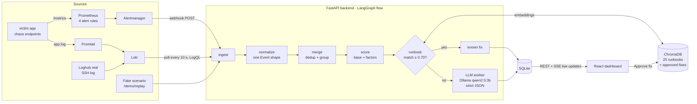

# Pager Intelligence

**Hundreds of alerts in, the two that matter out — each with a score you can explain and a fix you can trust, all on one laptop.**

Hackathon project for 1by0Grit · AI Ops track · problem AIO0001 *"The Pager That Cried Wolf"*.

On-call engineers get hundreds of alerts a day. Most are duplicates, small blips that fix themselves, or
symptoms of one underlying fault. People learn to ignore the pager and miss the one alert that matters.
Pager Intelligence groups the flood into a few incidents, scores each one with a written reason for
every point, finds the known fix in a runbook library, asks a **local** LLM when no runbook fits,
and learns from every fix an engineer approves.

| Run | Raw alerts + log lines | Incidents | Pages | Noise removed |
| --- | ---: | ---: | ---: | ---: |
| Demo scenario (fake data, 7 situations) | 386 | 7 | 2 | **98.2 %** |
| Live chaos run (Prometheus + Loki in Docker) | 405 | 7 | 2 | **98.3 %** |
| Live chaos + real SSH attack log (Loghub, 2,000 lines) | 1,568 | 10 | 2 | **99.4 %** |

---

## Run it (one command)

```powershell
powershell -ExecutionPolicy Bypass -File scripts\preflight.ps1     # green/red checklist, with the fix for each red item
powershell -ExecutionPolicy Bypass -File scripts\start_all.ps1     # starts everything, opens the dashboard
```
Then press **★ Demo story** in the dashboard (http://localhost:5173): a captioned ~3-minute walk through the
whole system. Stop everything with `scripts\stop_all.ps1`. macOS/Linux: `bash scripts/start_all.sh`.

- **Docker running** → LIVE + FAKE mode: real Prometheus/Loki stack, plus the demo data.
- **No Docker** → FAKE mode automatically. The demo story works fully offline (no internet, no Docker).
- **Ollama down** → the TLS incident shows a saved real LLM answer marked *cached*, so the story never stalls.

First-time setup (once):
```powershell
python -m venv .venv
.\.venv\Scripts\pip install -r requirements.txt     # ~250 MB, CPU-only PyTorch
cd frontend; npm install; cd ..
winget install Ollama.Ollama; ollama pull qwen2.5:3b # local LLM (~1.9 GB, fits a 4 GB GPU)
.\.venv\Scripts\python.exe demo.py                   # once with internet: caches the embedding model (~90 MB)
```
Optional for LIVE mode: Docker Desktop. Optional for real countries of real attackers: put MaxMind's free
`GeoLite2-Country.mmdb` in `data/` and `pip install geoip2` (otherwise a small built-in table is used).

---

## How it works



1. **Ingest.** Prometheus alerts arrive through Alertmanager's webhook; log lines are polled from Loki.
   Both are JSON in the exact formats the real tools use, so fake and real data take the same path.
2. **Normalize.** Every alert and log line becomes one `Event`: time, host, affected service, error type,
   message, source IP and its country.
3. **Fingerprint + group.** Numbers, IPs, user names and IDs are stripped from messages, so 120
   *"Login failed for user X from IP"* lines share one fingerprint. Events with the same error type,
   affected service and origin country join one incident while they keep coming (15-minute gap rule).
   That is how 1 *PostgresDown* alert and 200 *"Connection refused to db-primary"* log lines from 4 web
   servers become **one** database incident.
4. **Score.** A base score per error type plus context factors, up for real threats and down for noise.
   Every point is stored with its reason, and the dashboard shows it as a waterfall.
5. **Known fix (RAG).** The incident is described in words (title, messages, scoring reasons), turned into
   an embedding and compared with every runbook. Similarity ≥ 0.70 *and* the same error type = known fix.
6. **LLM fallback.** No match → a background worker asks a local LLM (Ollama) for root cause, impact,
   fix steps, prevention and a confidence, forced into a strict JSON schema and validated.
7. **Learning loop.** An engineer approves the AI fix → it is saved as a new runbook → the next time the
   same problem appears it is a known fix (similarity 0.98–0.99 in the demo), with no LLM call.
8. **Dashboard.** Live counter, incident cards, report with score waterfall, fix and raw evidence,
   charts; updates are pushed over Server-Sent Events.

### Scoring

| Factor | Points | When |
| --- | ---: | --- |
| Base: database down | 80 | error type `db_down` |
| Base: target down / disk full / TLS expired | 70 / 60 / 60 | |
| Base: high error rate / login failures / high CPU | 50 / 40 / 30 | |
| Base: slow requests / unclassified | 10 / 20 | |
| High-risk country | **+40** | source IPs in `HIGH_RISK_COUNTRIES` (demo: KP) |
| Burst | **+30** | ≥ 50 events inside any 5-minute window |
| Recurring | **+20** | ≥ 5 events over ≥ 10 minutes (if not a burst) |
| Critical asset | **+20** | affected service in `CRITICAL_SERVICES` (db-primary, payments-api) |
| Many hosts | **+15** | ≥ 3 hosts report it |
| Self-resolved blip | **−30** | every event resolved itself within 2 minutes (≤ 2 events) |

| Band | Score | Action |
| --- | ---: | --- |
| critical | ≥ 90 | **Page on-call** |
| high | 70–89 | Notify |
| medium | 40–69 | Show on dashboard |
| low | < 40 | Log only |

Every number lives in `core/config.py`. Demo results: KP brute force 40 + 40 + 30 = **110 → page**;
DB outage 80 + 30 + 20 + 15 = **145 → page**; CPU blip 30 − 30 = **0 → nobody woken up**.

---

## Folders

| Folder / file | What is in it |
| --- | --- |
| `core/` | The engine, plain Python: fake data generator (7 scenarios), normalizer, fingerprinting, geo lookup, grouping, scoring, and `config.py` with every tunable number. |
| `rag/` | Runbook library in ChromaDB: `store.py` (embeddings with all-MiniLM-L6-v2, exact cosine search, approve/forget), `matcher.py` (known fix or not). |
| `runbooks/` | 25 seed runbooks as JSON (no TLS runbook on purpose: that is the LLM case). `approved/` holds fixes engineers approved. |
| `llm/` | Ollama client with JSON-schema output, retry, timeout, warm-up and cached fallback; the SRE prompt; `cached/` saved answers. |
| `graph/` | The batch LangGraph flow used by `demo.py`. |
| `backend/` | FastAPI app: endpoints, incremental LangGraph flow, SQLite tables, SSE, LLM worker, Loki poller, demo replay. |
| `frontend/` | React + Vite + TypeScript + Tailwind dashboard, including the Demo story. |
| `infra/` | Docker Compose: victim app, Postgres, exporters, Prometheus (rules), Alertmanager (webhook), Loki, Promtail. |
| `scripts/` | `preflight`, `start_all`, `stop_all`, `chaos_demo`, `replay_loghub`. |
| `tests/` | 23 pytest tests (scoring, grouping, webhook parsing, approve, replay = batch, Loki poller, cached LLM, story). |
| `data/` | Offline copy of Loghub `OpenSSH_2k.log`; optional GeoLite2 database. |
| `docs/PITCH.md` | 3-minute pitch script, 30-second version, judge Q&A. |
| `demo.py` | Command-line version of the whole flow (`python demo.py --learn` shows the learning loop). |

Other useful commands:
```powershell
.\.venv\Scripts\python.exe -m pytest tests -q                          # 23 tests, ~40 s, no Ollama/Docker needed
.\.venv\Scripts\python.exe -m backend                                  # backend only; API docs at http://localhost:8000/docs
powershell -ExecutionPolicy Bypass -File scripts\chaos_demo.ps1        # break the live victim app (~7 min)
.\.venv\Scripts\python.exe scripts\replay_loghub.py --speed 240        # real SSH attacks into Loki (~1 min)
```
Data source switch: environment variable `PAGER_DATA_SOURCE` = `fake` | `live` | `both` (start_all picks it).

### Main API endpoints

`POST /webhook/alertmanager` · `POST /ingest/loki` · `POST /demo/replay` · `POST /demo/reset` · `POST /demo/inject/tls` ·
`GET /incidents?band=&status=` · `GET /incidents/{id}` · `POST /incidents/{id}/approve|reject|ack` ·
`GET /stats` · `GET /timeline` · `GET /stream` (SSE) · `GET /health`. Full list with a try-it UI at `/docs`.

---

## Tech stack

| Layer | Choice | Why |
| --- | --- | --- |
| Engine | Python 3.14, standard library | Small, readable, testable |
| Flow | LangGraph | The pipeline as an explicit graph with a conditional "needs LLM?" edge |
| API | FastAPI + SQLModel (SQLite) + Server-Sent Events | Simple, typed, live updates without websockets |
| Search | ChromaDB + sentence-transformers all-MiniLM-L6-v2 (CPU) | Local, offline after first download |
| LLM | Ollama, qwen2.5:3b (GPU, 4 GB) with JSON-schema output | Local: logs never leave the machine, no API key, no cost per call |
| Dashboard | React 19, Vite, TypeScript, Tailwind 4, Motion | Fast dev loop, live UI |
| Monitoring | Prometheus 3.5, Alertmanager 0.28, Loki 3.5, Promtail, node/postgres exporters | The tools ops teams already run |
| Tests | pytest (backend), Playwright with Edge (UI checks during development) | |

Measured on the dev laptop (RTX 3050 4 GB, 16 GB RAM): an LLM answer takes ~7–15 s on the GPU;
a runbook lookup ~0.02 s; the webhook answers in ~0.1–0.2 s because the LLM runs in the background.

## Honest limits

- Thresholds (RAG 0.70, burst 50 / 5 min, …) were tuned on the demo data, not on months of real traffic.
- Some live alerts (CPU, disk, error rate, real SSH attacks) had no close-enough runbook and went to the LLM;
  approving those fixes once teaches the system.
- Without the MaxMind database, real attacker IPs show country `ZZ` (unknown), so the geo factor cannot fire.
- One backend instance with SQLite; fine for a team, not yet for thousands of alerts per second.

## Roadmap

1. **Fine-tuning on approved fixes.** Once hundreds of approved fixes exist, use them to fine-tune the local model
   (LoRA) so its first answer matches the team's style and stack.
2. **Slack / PagerDuty / Opsgenie integration.** Send only critical incidents to the pager, with the score
   breakdown and fix in the message; approve or reject from Slack.
3. **Auto-remediation.** For approved runbooks with safe, reversible steps (restart a service, clear temp
   files, block an IP range), offer one-click or automatic execution with an audit log.
4. Learn the weights: use acknowledge/ignore feedback to adjust scoring factors per team.
5. Scale-out: Postgres instead of SQLite, a queue in front of ingest, several workers.
